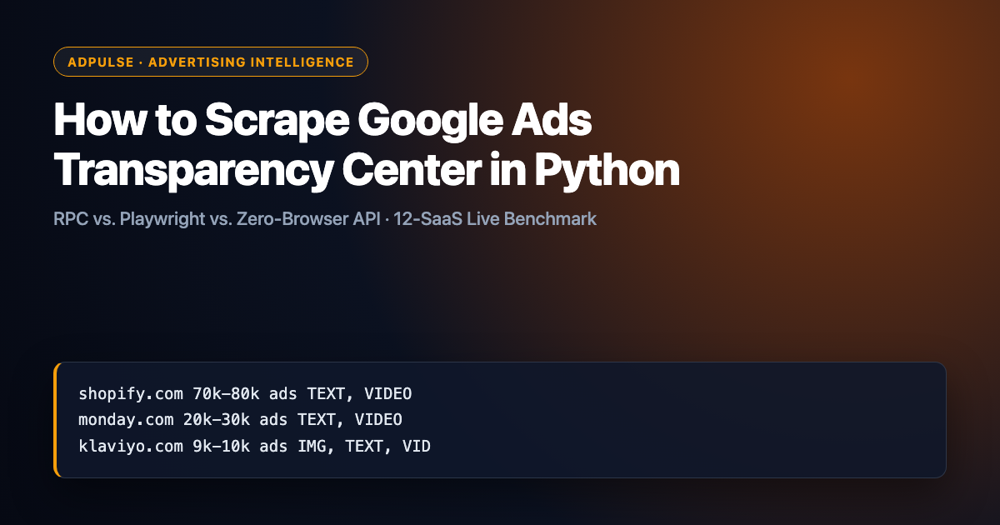

# Google Ads Transparency & Creative Spy — REST API & MCP Server

[](https://glama.ai/mcp/connectors/io.github.yun87457-web/google-ads-transparency-mcp)

Query active Google Search, YouTube, and Display ad creatives, formats, advertiser details, and EU DSA reach/impression bounds by domain or advertiser name — without headless browsers or proxies.

## Access Channels

- **Apify Store (Batch + Standby + Free Tier):** https://apify.com/spiky_closet/google-ads-transparency-scraper
- **RapidAPI Hub (REST API, Free Basic Plan):** https://rapidapi.com/HYunLe/api/google-ads-transparency-creative-spy
- **Official MCP Registry:** `io.github.yun87457-web/google-ads-transparency-mcp`

## Verified Performance (50-Domain Batch Benchmark)

- **50-domain ad-spend screening (`screeningMode: true`):** `2.47 s` runtime, `8.8 MB` peak RAM, `0` errors across US, DE, FR, KR, and JP advertisers.

## MCP Tools (Streamable HTTP)

Endpoint: `https://spiky-closet--google-ads-transparency-scraper.apify.actor/mcp`

| Tool | Description |
|---|---|
| `search_google_ads` | Retrieve active ad creatives by domain, advertiser name, region (`US`, `DE`, `FR`, `KR`, `JP`, `ALL`), format, or date range. |
| `check_domains_running_ads` | Batch screen a list of domains for verified Google Ads advertiser status and active creative counts. |
| `get_google_ad_creative` | Fetch detailed metadata, EU DSA reach bounds, and extracted ad copy for a specific creative ID. |

## Claude Desktop / Cursor MCP Configuration

```json
{
  "mcpServers": {
    "google-ads-transparency": {
      "url": "https://spiky-closet--google-ads-transparency-scraper.apify.actor/mcp",
      "headers": {
        "Authorization": "Bearer YOUR_APIFY_TOKEN"
      }
    }
  }
}
```

## REST Quick Start (cURL)

```bash
curl -sG "https://google-ads-transparency-creative-spy.p.rapidapi.com/search" \
  --data-urlencode "query=zalando.de" \
  --data-urlencode "region=DE" \
  --data-urlencode "maxResults=5" \
  -H "x-rapidapi-key: YOUR_RAPIDAPI_KEY" \
  -H "x-rapidapi-host: google-ads-transparency-creative-spy.p.rapidapi.com"
```

## Free n8n Workflow Template

Import the ready-to-run workflow (**Weekly Competitor Google Ads & EU DSA Creative Monitor**): [`n8n-template.json`](./n8n-template.json)

1. Download [`n8n-template.json`](./n8n-template.json) and click **Import from File** in n8n.
2. Add a Generic Header Auth credential (`x-rapidapi-key`) using your free RapidAPI key.
3. Replace the sample domain list and connect your Slack channel.

## Ready-to-Run Presets (Apify Public Tasks)
- [Google Ads Competitor Creative & Ad Copy Tracker](https://apify.com/spiky_closet/google-ads-transparency-scraper/examples/google-ads-competitor-creative-tracker)
- [EU DSA Google Ads Reach, Targeting & Payer Extractor](https://apify.com/spiky_closet/google-ads-transparency-scraper/examples/eu-dsa-google-ads-reach-extractor)
- [B2B Domain Google Ads Spend Signal Checker (Bulk)](https://apify.com/spiky_closet/google-ads-transparency-scraper/examples/b2b-domain-google-ads-spend-checker)
